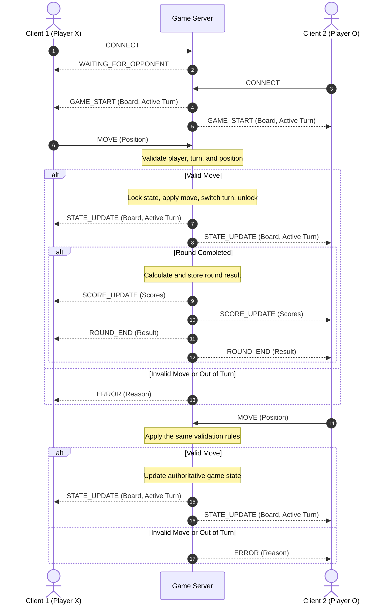

# State and Score Broadcast Sequence Diagram

This diagram illustrates the intended message flow for client connections, move validation, turn changes, and score updates. Message names are provisional and must be aligned with the project's actual protocol.

## Protocol Alignment Checklist

- [ ] Replace provisional message names with the actual protocol names.
- [ ] Include every message type used by the game.
- [ ] Confirm how clients are assigned player identities.
- [ ] Confirm how the server handles a waiting player and a newly joined opponent.
- [ ] Include the actual round-completion and game-over behavior.
- [ ] Include the defined disconnection behavior.
- [ ] Verify that score updates reach both clients after score changes.
